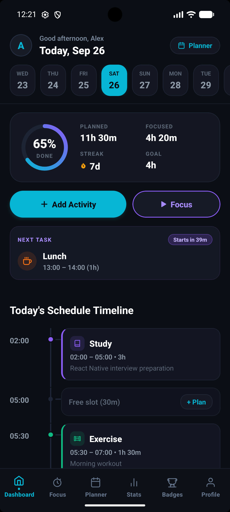
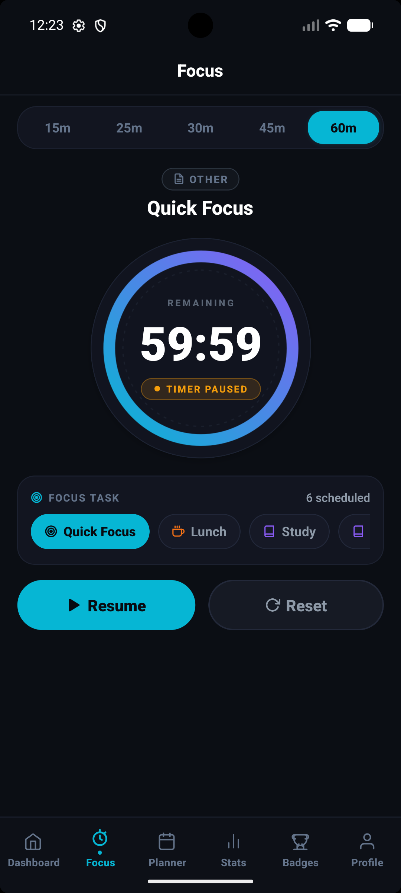
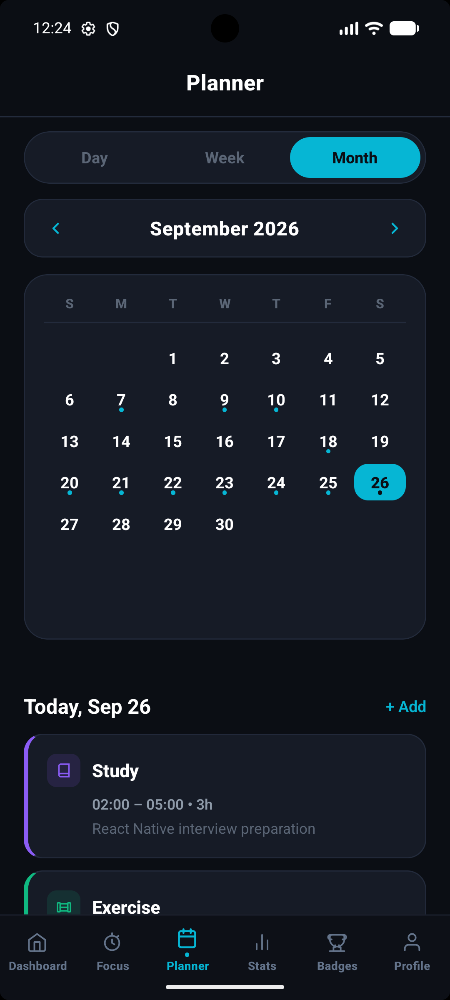
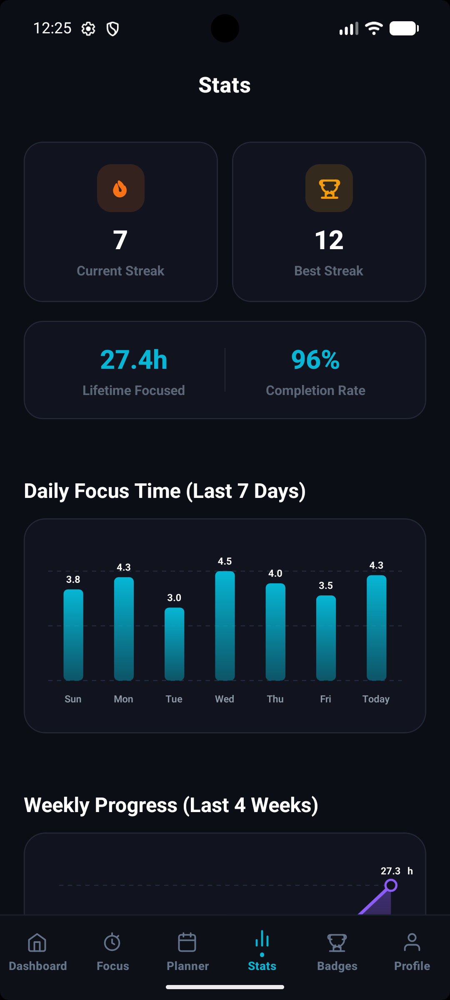
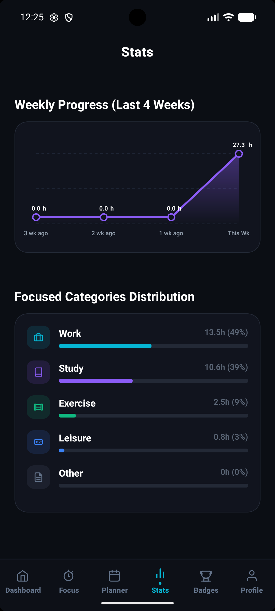
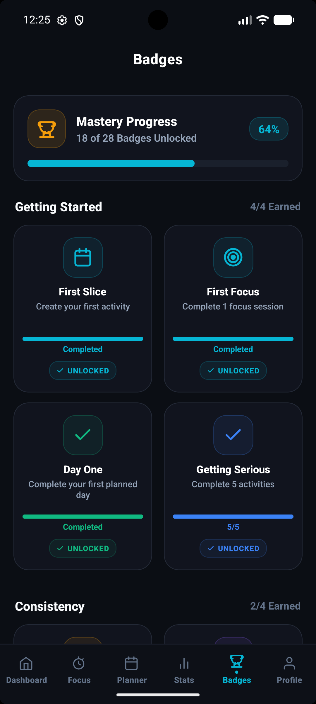

# TimeSlice — React Native App

TimeSlice is a mobile application project designed to help users organize and manage their activities through a mobile interface.

## Features

- Firebase Authentication
- Cloud Firestore integration
- Home screen and activity management
- Add Activity screen
- Profile screen
- Bottom tab navigation
- Map interface
- Camera and photo library permissions

## Tech Stack

- React Native CLI
- JavaScript
- Firebase Authentication
- Cloud Firestore
- React Navigation
- Android

## Screenshots

### Home Screen


### Focus Screen


### Planner Screen


### Statistics Screen


### Badges Screen


### Additional Screen



## Getting Started

### Prerequisites

- Node.js and npm
- Android Studio
- Android SDK and required build tools
- A configured React Native development environment

### Installation

1. Clone the repository:

   ```bash
   git clone https://github.com/Deshraj-dev/TimeSlice.git
   ```

2. Open the project directory:

   ```bash
   cd TimeSlice
   ```

3. Install dependencies:

   ```bash
   npm install
   ```

4. Configure the required Firebase project settings.

5. Start Metro:

   ```bash
   npm start
   ```

6. In another terminal, run the Android app:

   ```bash
   npm run android
   ```

Check the project's package.json and current setup instructions before running these commands.

## Project Status

React Native application project. Refer to the repository for the current implementation.

## Author

Deshraj Singh

- GitHub: https://github.com/Deshraj-dev
- LinkedIn: https://www.linkedin.com/in/deshraj-singh-398949376/
